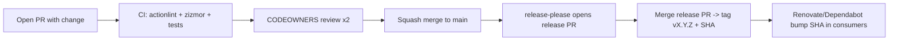

# Contributing to aircloud

> Organization-default contribution guide. Repositories that do not ship their own `CONTRIBUTING.md` inherit
> this one. This document also governs contributions to **this** repo (`aircloud/.github`).

Thanks for taking the time to contribute! This guide covers how we work across the `aircloud` org and the
specific rules for evolving the **reusable workflows** that live here.

## TL;DR

```bash
make setup            # install pre-commit hooks + local tooling
# ... make your change ...
make lint test        # must pass locally
git commit -s -m "feat: add X"   # signed + Conventional Commit
# open a PR; CI + CODEOWNERS review required
```

## Ground rules

- Be excellent to each other — see [`CODE_OF_CONDUCT.md`](CODE_OF_CONDUCT.md).
- **Never commit secrets.** `gitleaks` runs in pre-commit and CI. Use OIDC, not long-lived tokens.
- Keep PRs focused and small. One logical change per PR.
- All changes go through a PR; **direct pushes to `main` are blocked** by the org ruleset.

## Conventional Commits

We use [Conventional Commits](https://www.conventionalcommits.org/) so that **release-please** can compute the
next SemVer version and generate changelogs automatically.

```
<type>(<optional scope>)<optional !>: <description>

[optional body]

[optional footer(s)]
```

Common types: `feat`, `fix`, `docs`, `refactor`, `perf`, `test`, `build`, `ci`, `chore`, `revert`.

- `feat:` → minor bump. `fix:` → patch bump.
- A `!` after the type/scope **or** a `BREAKING CHANGE:` footer → major bump.

Examples:

```
feat(reusable-ci): add coverage gate input
fix(reusable-container): pin syft to digest
feat(reusable-terraform)!: drop support for Terraform < 1.7

BREAKING CHANGE: callers must set terraform-version >= 1.7.
```

## Signed (verified) commits — required

The org ruleset **requires verified, signed commits** on protected branches. Configure signing once:

```bash
# SSH signing (simplest)
git config --global gpg.format ssh
git config --global user.signingkey ~/.ssh/id_ed25519.pub
git config --global commit.gpgsign true
# then add the public key to GitHub as a *signing* key:
#   Settings → SSH and GPG keys → New SSH key → Key type: Signing Key
```

GPG and S/MIME signing are also accepted. Always commit with `-s` to add a DCO `Signed-off-by` trailer in
addition to the cryptographic signature.

## Branching & PR flow

1. Branch from `main`: `git switch -c feat/short-description`.
2. Make the change; run `make lint test` (and `make security` if touching CI).
3. Push and open a PR. Fill in the PR template.
4. CI must be green and **CODEOWNERS must approve** (2 approvals required by the ruleset).
5. We use **squash merge**; the squash title must be a valid Conventional Commit (it becomes the changelog entry).
6. History is **linear** (no merge commits, no force-push to protected branches).

See [`docs/BRANCH-PROTECTION.md`](docs/BRANCH-PROTECTION.md) for the exact required status checks and ruleset.

## Evolving the reusable workflows (important)

Changes here ripple to **every consuming repo**. Treat compatibility seriously:

- **Versioning is SemVer.** A change that alters inputs/secrets/outputs or default behavior is **breaking** —
  use `!`/`BREAKING CHANGE:` so release-please cuts a **major** version.
- **Consumers pin by full commit SHA**, so old pins keep working. Never rewrite published history.
- Add new behavior **behind new inputs with safe defaults** rather than changing existing defaults.
- Document every input/secret/output in the workflow header comment and in [`README.md`](README.md).
- When you cut a release, update the SHA in [`examples/consumer-ci.yml`](examples/consumer-ci.yml) and mention
  the migration in the release notes.

A typical lifecycle:



## Local tooling

`make setup` installs:
- [`pre-commit`](https://pre-commit.com/) hooks (gitleaks, end-of-file, trailing-whitespace, yamllint, actionlint).
- [`actionlint`](https://github.com/rhysd/actionlint) for workflow linting.
- [`zizmor`](https://github.com/woodruffw/zizmor) for workflow security auditing.

Run `make lint` before pushing. CI runs the same checks.

## Reporting bugs / requesting features

Use the issue templates under **New issue**. For security issues, **do not** open a public issue — follow
[`SECURITY.md`](SECURITY.md).

## License

By contributing, you agree that your contributions will be licensed under the [Apache-2.0](LICENSE) license.
