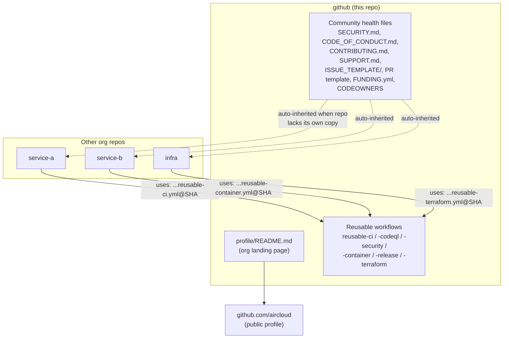
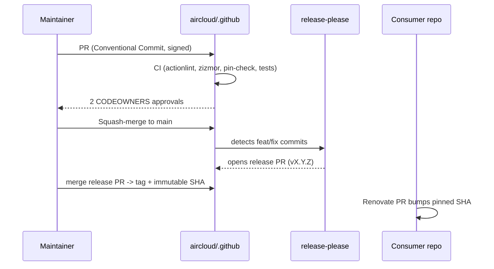

# Architecture

This repository is the `aircloud` organization's special **`.github`** repo. It has two distinct
responsibilities, delivered by two different GitHub mechanisms:

1. **Org-default community health files** — inherited automatically by any org repo that lacks its own copy.
2. **Reusable workflows** — referenced explicitly by other repos via `uses: ... @<sha>`.

## Replaceable identifiers

This is a template. Search-and-replace these before publishing into your own org:

| Placeholder | Meaning | Appears in |
| --- | --- | --- |
| `aircloud` | GitHub org name | everywhere (`uses:`, CODEOWNERS teams, URLs) |
| `ghcr.io/aircloud` | Container registry namespace | `reusable-container.yml`, `examples/` |
| `aircloud` (Azure prefix) | Azure resource naming prefix | `reusable-terraform.yml`, docs |
| `*.aircloud.example` | Domains/emails (security.txt, contacts) | `SECURITY.md`, `SUPPORT.md`, profile |
| `@aircloud/*` | GitHub teams | `.github/CODEOWNERS` |

## How the two mechanisms work



> **Key difference:** community health files are *inherited by absence*; reusable workflows are *opted into by
> reference*. Inheritance respects visibility (a public `.github` repo does not seed private repos and vice
> versa).

## Supply-chain pipeline (container path)

```mermaid
flowchart LR
  A[Buildx build] --> B[Syft SBOM\nCycloneDX]
  A --> C[Push to GHCR\nby digest]
  C --> D[cosign keyless sign\nOIDC / Fulcio / Rekor]
  C --> E[SLSA build-provenance\nattestation]
  B --> F[SBOM attestation\nto image]
  C --> G[Trivy image scan\nSARIF -> code scanning]
  D --> H{{Verifiable\nghcr.io/aircloud/img@sha256:...}}
  E --> H
  F --> H
```

## Security model

- **Identity, not secrets.** Cloud auth (`azure/login`) and signing (`cosign`) use **GitHub OIDC** federated
  identity. There are **no long-lived cloud credentials** anywhere in this repo.
- **Hardened runners.** Every job's first step is `step-security/harden-runner`. Start in `audit`; move to
  `block` with an egress allowlist once a workflow's network needs are known.
- **Least privilege.** Top-level `permissions: { contents: read }`; jobs request only the scopes they use
  (`packages: write`, `id-token: write`, `security-events: write`, etc.).
- **Pinned everything.** Actions → 40-hex SHA; images → digest; deps → lockfiles + Renovate/Dependabot.
- **Defense in depth scanning.** CodeQL, Semgrep, Trivy (fs + image), gitleaks, dependency-review, OpenSSF
  Scorecard, plus tfsec/checkov/conftest for IaC.

## Evolving reusable workflows

Reusable workflows are **SemVer**-versioned via `release-please`. Consumers **pin by full commit SHA**, so a
published version is immutable from their perspective — they upgrade by changing the SHA in a reviewed PR
(opened automatically by Renovate/Dependabot).



Rules: changing inputs/secrets/outputs or defaults is **breaking** (major). Prefer new inputs with safe
defaults. See [`CONTRIBUTING.md`](../CONTRIBUTING.md#evolving-the-reusable-workflows-important).

---

## Runbook: cut and roll out a new reusable-workflow version

**When:** you merged a change to `.github/workflows/reusable-*.yml` and want consumers to adopt it.

1. **Confirm the release PR.** After merge to `main`, `release-please` opens/updates a release PR. Verify the
   computed version matches intent (a `feat:` → minor; a `BREAKING CHANGE:` → major).
2. **Merge the release PR.** This creates the tag `vX.Y.Z` and an immutable commit SHA.
3. **Capture the SHA:**
   ```bash
   gh api repos/aircloud/.github/git/refs/tags/vX.Y.Z --jq .object.sha
   ```
4. **Update the example.** Bump the pinned SHA in [`examples/consumer-ci.yml`](../examples/consumer-ci.yml) and
   in this repo's README snippets.
5. **Announce.** Note any migration steps in the GitHub release notes (especially for major versions).
6. **Let automation roll it out.** Renovate/Dependabot open PRs in consumer repos to bump the SHA; reviewers
   merge after CI passes. For breaking changes, pin consumers deliberately and migrate per the notes.

**Rollback:** consumers simply keep (or revert to) the previous SHA — old versions remain valid because nothing
rewrites history. If a published version is dangerous, open a security advisory and ask consumers to pin to the
prior SHA.

## Runbook: triage a failing consumer pipeline that calls our reusable workflow

1. Open the failing run; identify which **reusable workflow + job + step** failed (the job name encodes it,
   e.g. `reusable-container / build · sbom · sign · attest · scan`).
2. Reproduce locally where possible (`make lint`, `make security`, or the specific tool, e.g. `trivy fs`).
3. If it's an **action regression**, check whether a Dependabot/Renovate bump changed a pinned SHA; revert the
   bump SHA in a PR if needed.
4. If it's a **permissions** error, confirm the consumer granted the required job-level scopes (see each
   workflow's header). Reusable workflows cannot grant themselves more than the caller allows.
5. If it's an **OIDC/Azure** error, verify the federated credential subject matches the repo/branch/environment
   and that `id-token: write` is granted by the caller.
6. File an issue using the **Bug report** template with the run URL if the fix belongs in this repo.
